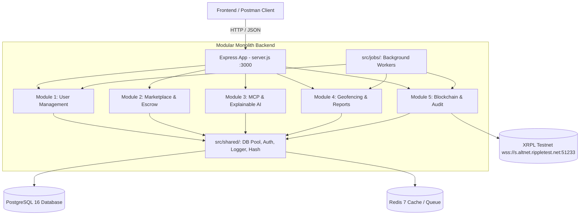
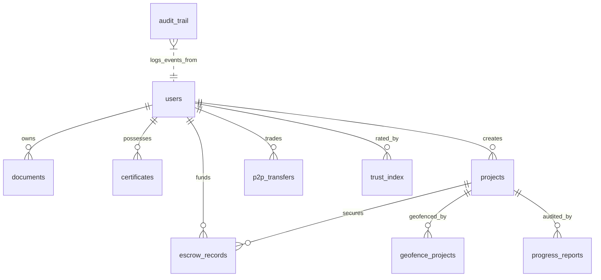

# PlanTrust Backend — Comprehensive System Documentation

**System Version:** `0.1.0`  
**Architecture:** Unified Modular Monolith (Express.js, PostgreSQL 16, Redis 7, XRPL Testnet)  
**Repository:** `planttrust-backend`  
**Frontend Companion:** `planttrust-frontend` (Next.js)

---

## Table of Contents

1. [Executive Summary & System Architecture](#1-executive-summary--system-architecture)
2. [Workload Balance & Module Ownership](#2-workload-balance--module-ownership)
3. [Module Deep-Dives](#3-module-deep-dives)
   - [Module 1: User Management & Corporate Registry](#module-1--user-management--corporate-registry)
   - [Module 2: Investor Marketplace & Investment Lifecycle](#module-2--investor-marketplace--investment-lifecycle)
   - [Module 3: MCP-Driven Explainable AI & Chatbot](#module-3--mcp-driven-explainable-ai--chatbot)
   - [Module 4: Company Portal & Proof-of-Reality (Geofencing)](#module-4--company-portal--proof-of-reality-geofencing)
   - [Module 5: Blockchain Auditing & Regulatory Dashboard](#module-5--blockchain-auditing--regulatory-dashboard)
4. [Database Architecture & Data Dictionary](#4-database-architecture--data-dictionary)
5. [Shared Infrastructure & Utilities](#5-shared-infrastructure--utilities)
6. [Inter-Module API Contracts](#6-inter-module-api-contracts)
7. [Local Environment & Developer Guide](#7-local-environment--developer-guide)
8. [Testing & Quality Assurance](#8-testing--quality-assurance)
   - [Automated Unit & Integration Tests (Jest)](#automated-unit--integration-tests-jest)
   - [API Testing with Postman (No Frontend Needed)](#api-testing-with-postman-no-frontend-needed)
9. [Git Workflow, PR Guidelines & CI/CD](#9-git-workflow-pr-guidelines--cicd)
10. [Checkpoint Roadmap & Contribution Tracking](#10-checkpoint-roadmap--contribution-tracking)

---

## 1. Executive Summary & System Architecture

PlanTrust is a blockchain-anchored agricultural and real estate land investment platform. The system facilitates:
- Rigorous company onboarding and corporate land deed verification (OCR + Human-in-the-Loop review).
- Escrow-backed investment funding with state-machine security.
- Proof-of-Reality milestone verification using GPS polygon geofencing, EXIF anti-spoofing, and perceptual hashing.
- Explainable AI risk assessment and Model Context Protocol (MCP) chatbot interactions.
- Cryptographic anchoring of every platform event into Merkle trees committed to the XRP Ledger (XRPL) Testnet.

### Architecture Diagram



### Key Technical Stack

| Layer | Technology | Purpose |
|---|---|---|
| **Runtime** | Node.js (v20+ Alpine) / Express.js (v4.21) | REST API routing and HTTP server |
| **Database** | PostgreSQL 16 (via `pg` Pool) | Relational persistence, JSONB schemas, spatial metadata |
| **Cache & Queue** | Redis 7 Alpine | Rate-limiting, session store, background job queues |
| **Blockchain** | XRPL.js (`xrpl` v4.0.0) | Ledger anchoring, NFT minting, cryptographic transaction submission |
| **Image & Vision AI** | Sharp (v0.33) & Vision LLM (Gemini / GPT-4o) | Image processing, EXIF inspection, intelligent document extraction |
| **Authentication** | JWT (`jsonwebtoken` v9.0) & Bcrypt.js (v2.4) | Stateless token auth & secure salted password hashing |
| **Logging** | Pino (v9.4) & Pino-Pretty | Structured JSON logging with module tags |
| **Testing** | Jest (v29.7) & Supertest (v7.0) | Automated unit, route, and integration smoke testing |

---

## 2. Workload Balance & Module Ownership

Each module spans **all five technical layers** (Frontend, Backend, Database, AI, Blockchain), ensuring equal team member contribution:

| Module | Code Folder | Owner | Effort Score (1-5 each) | Key AI Feature | Key Blockchain Feature |
|---|---|---|:---:|---|---|
| **M1** | `src/module-1-user-management/` | _Nimsara Karunarathna_ | **16** | OCR + confidence scoring + vision fallback | Certificate verification lookup |
| **M2** | `src/module-2-marketplace/` | _Thilina Dasun_ | **17** | Investment-pattern anomaly detector | XRPL NFT minting for investor stakes |
| **M3** | `src/module-3-mcp-ai/` | _Imesha Ariyawansha_ | **16** | Scam classifier + CBSL rule engine | Audit log retrieval w/ proof-of-inclusion |
| **M4** | `src/module-4-geofencing/` | _Yasuri Pradeepika_ | **16** | dHash duplicate-detection + anti-spoofing | Milestone timeline w/ inclusion-proof badges |
| **M5** | `src/module-5-blockchain/` | _Mirath Nimsara_ | **17** | Digital Trust Index (weighted composite) | Core Merkle + XRPL pipeline |

---

## 3. Module Deep-Dives

### Module 1 — User Management & Corporate Registry
- **Base Routes:** `/api/auth`, `/api/documents`, `/api/certificates`
- **Primary Function:**
  1. Onboarding and role management (`investor`, `company`, `admin`).
  2. Multi-document upload (land deeds, registration filings).
  3. OCR extraction with confidence scoring. Low-confidence extractions are flagged for Admin Human-in-the-Loop (HITL) review.
  4. Digital Trust Certificate issuance: hashes the certificate and submits it to Module 5 for XRPL anchoring.
- **Key Files:**
  - `src/module-1-user-management/routes/auth.js`
  - `src/module-1-user-management/routes/documents.js`
  - `src/module-1-user-management/routes/certificates.js`

### Module 2 — Investor Marketplace & Investment Lifecycle
- **Base Routes:** `/api/listings`, `/api/escrow`, `/api/transfers`
- **Primary Function:**
  1. Projects listing with risk-based ranking (derived from Module 5's Trust Index).
  2. Escrow State Machine enforcing strict 5-stage lifecycle:
     $$\text{CREATED} \longrightarrow \text{FUNDED} \longrightarrow \text{LOCKED} \longrightarrow \begin{cases} \text{RELEASED} & \text{(Milestone approved)} \\ \text{REFUNDED} & \text{(Default / cancellation)} \end{cases}$$
  3. P2P secondary marketplace enabling investors to trade tokenized shares atomically.
  4. Triggers Module 5 to mint an XRPL NFT upon investment completion.
- **Key Files:**
  - `src/module-2-marketplace/routes/listings.js`
  - `src/module-2-marketplace/routes/escrow.js`
  - `src/module-2-marketplace/routes/transfers.js`

### Module 3 — MCP-Driven Explainable AI & Chatbot
- **Base Routes:** `/api/mcp`, `/api/chatbot`, `/api/scam`
- **Primary Function:**
  1. Custom Model Context Protocol (MCP) Server implementing JSON-RPC 2.0 to expose scoped tool calls to LLM agents.
  2. Central Bank of Sri Lanka (CBSL) compliance rules engine.
  3. Typology-matching scam classifier identifying fraudulent offers.
  4. Natural language explainability chatbot querying on-chain audit proofs for investors.
- **Key Files:**
  - `src/module-3-mcp-ai/routes/mcp.js`
  - `src/module-3-mcp-ai/routes/chatbot.js`
  - `src/module-3-mcp-ai/routes/scam.js`

### Module 4 — Company Portal & Proof-of-Reality (Geofencing)
- **Base Routes:** `/api/projects`, `/api/reports`, `/api/geofence`
- **Primary Function:**
  1. Polygon boundary registration using GeoJSON coordinates.
  2. Point-in-polygon ray-casting engine to ensure progress reports are submitted from within the boundary.
  3. EXIF metadata extraction to prevent GPS spoofing and timestamp alteration.
  4. Perceptual hashing (`dHash`) to detect reused/duplicate milestone photos.
  5. Upon milestone verification and approval, triggers Module 2's `/api/escrow/release` endpoint.
- **Key Files:**
  - `src/module-4-geofencing/routes/projects.js`
  - `src/module-4-geofencing/routes/reports.js`
  - `src/module-4-geofencing/routes/geofence.js`

### Module 5 — Blockchain Auditing & Regulatory Dashboard
- **Base Routes:** `/api/audit`, `/api/trust-index`, `/api/verify`
- **Primary Function:**
  1. Central Merkle tree batching service for all cross-module SHA-256 event hashes.
  2. XRPL Testnet anchoring pipeline with automated transaction retries and nonce handling.
  3. Digital Trust Index (0–100 composite score) calculated using:
     $$\text{TrustIndex} = w_1(\text{KYC}_{\text{M1}}) + w_2(\text{Escrow}_{\text{M2}}) - w_3(\text{ScamFlags}_{\text{M3}}) + w_4(\text{Milestones}_{\text{M4}})$$
  4. Public cryptographic proof-of-inclusion verification (`/api/verify/:hash`).
- **Key Files:**
  - `src/module-5-blockchain/routes/audit.js`
  - `src/module-5-blockchain/routes/trust-index.js`
  - `src/module-5-blockchain/routes/verify.js`

---

## 4. Database Architecture & Data Dictionary

All tables are defined in [`src/database/init.sql`](file:///d:/Website%20Projects/planttrust-backend/src/database/init.sql).

### Entity Relationship Summary



### Complete Schema Specification

| Table | Module | Key Columns | Purpose |
|---|---|---|---|
| `users` | M1 | `id` (UUID PK), `email` (UNIQUE), `password` (Hash), `role`, `name`, `phone` | Identity and access control |
| `documents` | M1 | `id` (UUID PK), `user_id` (FK), `document_type`, `file_path`, `ocr_confidence`, `status` | Uploaded deeds and verification docs |
| `certificates` | M1 | `id` (UUID PK), `company_id`, `certificate_number` (UNIQUE), `data_hash`, `xrpl_tx_hash` | Anchored Digital Trust Certificates |
| `projects` | M2 | `id` (UUID PK), `company_id` (FK), `title`, `target_amount`, `funded_amount`, `status`, `risk_level` | Marketplace investment projects |
| `escrow_records` | M2 | `id` (UUID PK), `project_id` (FK), `investor_id` (FK), `amount`, `status`, `nft_token_id` | Escrow state machine records |
| `p2p_transfers` | M2 | `id` (UUID PK), `seller_id` (FK), `buyer_id` (FK), `escrow_id` (FK), `amount`, `price`, `status` | Secondary share transactions |
| `scam_typologies` | M3 | `id` (UUID PK), `category`, `pattern`, `risk_weight`, `cbsl_rule_reference` | Rule patterns for scam detection |
| `scam_reports` | M3 | `id` (UUID PK), `reported_by` (FK), `target_url`, `risk_score`, `typology_matches` | Flagged suspicious activities |
| `chatbot_conversations` | M3 | `id` (UUID PK), `user_id` (FK), `session_id`, `messages` (JSONB) | Interactive chat state persistence |
| `geofence_projects` | M4 | `id` (UUID PK), `project_id` (FK), `name`, `polygon_coordinates` (JSONB) | GeoJSON land boundaries |
| `progress_reports` | M4 | `id` (UUID PK), `project_id` (FK), `image_url`, `exif_latitude`, `exif_longitude`, `dhash`, `status` | Verified milestone progress submissions |
| `audit_trail` | M5 | `id` (UUID PK), `source_module`, `event_type`, `entity_id`, `data_hash`, `merkle_root`, `xrpl_tx_hash`, `status` | Global immutable audit ledger |
| `trust_index` | M5 | `id` (UUID PK), `company_id` (FK), `score` (0-100), `components` (JSONB) | Real-time computed trustworthiness |

---

## 5. Shared Infrastructure & Utilities

Located in [`src/shared/`](file:///d:/Website%20Projects/planttrust-backend/src/shared/):

- **`db.js`**: Managed `pg.Pool` connection wrapper. Exposes `.query(text, params)` with automated query logging and connection pooling.
- **`auth-middleware.js`**: Provides `verifyToken` for standard JWT verification and `requireRole(role)` for role-based access control.
- **`error-handler.js`**: Handles unknown routes (`notFoundHandler`, 404) and uncaught server errors (`globalErrorHandler`, 500) with sanitized JSON responses.
- **`hash.js`**: `hashEvent(data)` generates deterministic SHA-256 hexadecimal digests for strings and JSON objects.
- **`logger.js`**: Pino logger factory (`logger(moduleName)`) providing formatted output in local development and JSON output in production.

---

## 6. Inter-Module API Contracts

Modules interact exclusively through defined HTTP contracts (never by reading each other's database tables):

| Caller | Provider | Endpoint | Method | Payload / Response |
|---|---|---|:---:|---|
| Frontend / M2 | M1 | `/api/certificates/:id/verify` | `GET` | Returns on-chain verification status of a company certificate |
| M1, M2, M3, M4 | M5 | `/api/audit/anchor` | `POST` | `{ sourceModule, eventType, dataHash }` $\rightarrow$ `{ anchorId, status: "PENDING" }` |
| M2 | M5 | `/api/audit/mint` | `POST` | `{ investorId, projectId, amount }` $\rightarrow$ `{ nftTokenId, xrplTxHash }` |
| M4 | M2 | `/api/escrow/release` | `POST` | `{ projectId, milestoneId }` $\rightarrow$ Transitions escrow to `RELEASED` |
| Public / Chatbot | M5 | `/api/verify/:hash` | `GET` | Returns Merkle inclusion proof and XRPL ledger confirmation |
| M2 / Dashboard | M5 | `/api/trust-index/:companyId` | `GET` | Returns `{ score: 85, components: { ... } }` |

---

## 7. Local Environment & Developer Guide

### Prerequisites
- Node.js `v20.x` or higher
- Docker Desktop (for Postgres 16 & Redis 7)
- Postman (for manual API testing)

### Quick Start
```bash
# 1. Clone repository & install dependencies
git clone https://github.com/planttrust/planttrust-backend.git
cd planttrust-backend
npm install

# 2. Configure environment
cp .env.example .env

# 3. Spin up PostgreSQL and Redis
docker-compose up -d db redis

# 4. Initialize Database Schema
npm run db:init

# 5. Start development server with auto-reload
npm run dev
```

Server will listen on `http://localhost:3000`.

---

## 8. Testing & Quality Assurance

### Automated Unit & Integration Tests (Jest)
Tests live in [`tests/app.test.js`](file:///d:/Website%20Projects/planttrust-backend/tests/app.test.js).
```bash
# Run test suite
npm test
```
**Current Coverage:**
- Health check (`GET /health`)
- 404 Error Handler (`GET /api/nonexistent`)
- Auth Route status & input validation (`/api/auth/register`, `/api/auth/login`)
- Scaffolding reachability for all 14 endpoints across Modules 1–5.

### API Testing with Postman (No Frontend Needed)
Import the pre-configured Postman Collection:
📁 [`docs/postman/PlanTrust_API.postman_collection.json`](file:///d:/Website%20Projects/planttrust-backend/docs/postman/PlanTrust_API.postman_collection.json)

**Features:**
- **Automatic Token Handling:** Registering or logging in saves the JWT into `{{token}}`.
- **Pre-configured Payloads:** Includes valid JSON bodies for users, listings, reports, and audit hashes.
- **Full Run Automation:** Click **Run collection** to run all module tests in sequence.

---

## 9. Git Workflow, PR Guidelines & CI/CD

### Branching Hierarchy
- `main` — Production-ready baseline. Protected: no direct pushes.
- `develop` — Shared integration branch. All PRs target `develop`.
- `feature/<module>/<ticket-name>` — Feature branches created from `develop`.

### Opening a Pull Request
1. Branch from `develop`:
   ```bash
   git checkout develop
   git pull origin develop
   git checkout -b feature/m1/ocr-service
   ```
2. Commit with module prefix:
   ```bash
   git commit -m "module-1: integrate vision ai document extraction"
   ```
3. Push and open PR targeting **`develop`**:
   - The PR template ([`.github/pull_request_template.md`](file:///d:/Website%20Projects/planttrust-backend/.github/pull_request_template.md)) will load automatically.
   - Mention the closing issue: `Fixes #8`.
4. Automated GitHub Actions ([`.github/workflows/ci.yml`](file:///d:/Website%20Projects/planttrust-backend/.github/workflows/ci.yml)) will run Jest tests and Docker container smoke tests.
5. Reviewer will be automatically assigned via [`.github/CODEOWNERS`](file:///d:/Website%20Projects/planttrust-backend/.github/CODEOWNERS).

---

## 10. Checkpoint Roadmap & Contribution Tracking

The project runs on a 14-week schedule with seven 2-week checkpoints:

| Checkpoint | Weeks | Primary Focus |
|:---:|:---:|---|
| **CP 1** | 1–2 | Schema completion; Auth API working; Stub audit logging function. |
| **CP 2** | 3–4 | OCR + HITL review; Escrow COMMITTED logic; First real XRPL hash anchoring. |
| **CP 3** | 5–6 | Polygon map UI; Marketplace UI reads real M1 data; Chatbot shell. |
| **CP 4** | 7–8 | Real escrow funding flow; In-app camera capture; First live MCP query tool. |
| **CP 5** | 9–10 | Escrow LOCKED $\rightarrow$ RELEASED endpoint; XRPL NFT Minting Service. |
| **CP 6** | 11–12 | **Marquee Integration:** Report approval automatically releases escrow, AI risk-checked and audited. |
| **CP 7** | 13–14 | P2P purchase flow; Perceptual dHash; Digital Trust Index live on real data; Feature freeze. |

---
*Maintained by the PlanTrust Engineering Team.*
